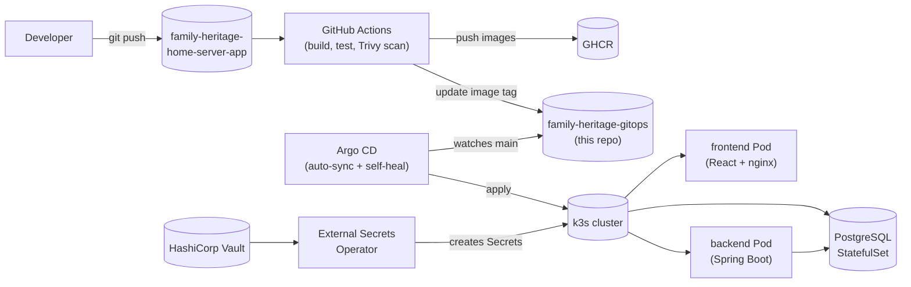
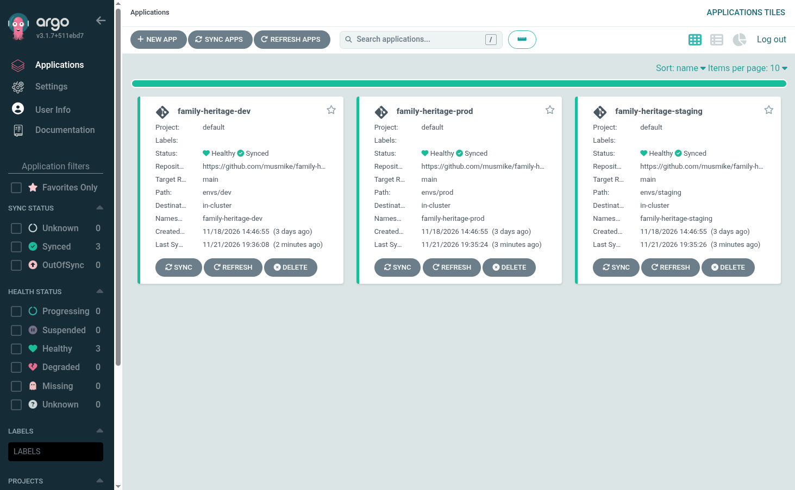
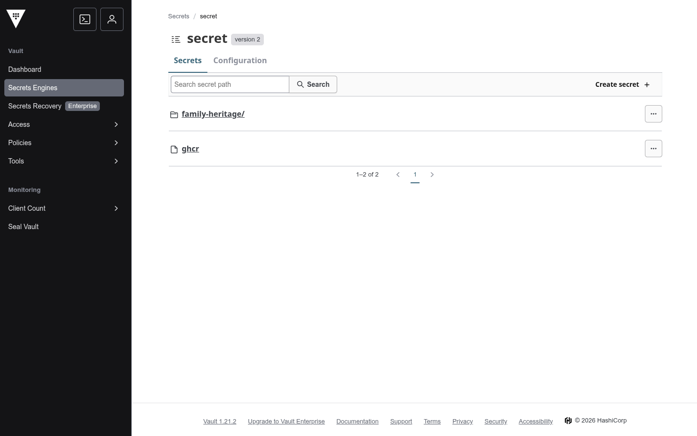

# Family Heritage — GitOps

Kubernetes deployment configuration for the [Family Heritage Home Server App](https://github.com/musmike/family-heritage-home-server-app), managed with **Argo CD** on a **k3s** home server. This repository is the single source of truth for what runs in each environment — nothing is deployed by running `kubectl apply` by hand.

Three independent environments (**dev**, **staging**, **prod**) run side by side on the same cluster, each with its own namespace, database, media storage and image tag.

---

## Architecture



A push to the application repository builds and scans Docker images, publishes them to GHCR, and commits the new image tag into the matching `envs/<environment>/values.yaml` file **in this repository**. Argo CD watches `main` here and rolls the change out automatically.

---

## Repository structure

```
argocd/                      Argo CD Application manifests (one per environment)
charts/family-heritage/      The Helm chart shared by all three environments
  templates/backend/            Deployment + Service for the Spring Boot API
  templates/frontend/           Deployment + Service for the React app (nginx)
  templates/postgres/           StatefulSet + headless/ClusterIP Services
  templates/ingressroute.yaml    Traefik IngressRoute (path-based routing)
  values.yaml                   Chart defaults
envs/
  dev/      values.yaml, PersistentVolumes, ExternalSecrets for dev
  staging/  values.yaml, PersistentVolumes, ExternalSecrets for staging
  prod/     values.yaml, PersistentVolumes, ExternalSecrets for prod
infrastructure/
  cluster-secret-store.yaml  Vault-backed ClusterSecretStore (shared by all envs)
```

Each Argo CD `Application` is a **multi-source** app: one source is a plain directory of YAML (the environment's `PersistentVolume`s and `ExternalSecret`s), the other is the Helm chart, parameterized with that environment's `values.yaml` via the `ref: values` mechanism. This keeps environment-specific infrastructure (volumes, secrets) and the application template (the chart) cleanly separated.

---

## Environments

| Environment | Namespace | Host | Image tag source |
|---|---|---|---|
| **dev** | `family-heritage-dev` | `familyheritage.dev.<local-address>.nip.io` | `envs/dev/values.yaml` |
| **staging** | `family-heritage-staging` | `familyheritage.staging.<local-address>.nip.io` | `envs/staging/values.yaml` |
| **prod** | `family-heritage-prod` | `familyheritage.<local-address>.nip.io` | `envs/prod/values.yaml` |

Each environment's `IngressRoute` serves **both** the frontend and the API from a single host: requests to `/api/*` are routed to the backend Service, everything else to the frontend.

All three environments run on the same physical node, referenced by `nodeSelector`/`nodeAffinity` on the local `PersistentVolume`s.

---

## Secrets management: Vault + External Secrets Operator

No secret is committed to this repository in plaintext. Every `ExternalSecret` resource (database credentials, the JWT signing key, seeded demo users, the GHCR image-pull credentials) is a *reference* to a key in **HashiCorp Vault**, resolved at apply time:

1. A single `ClusterSecretStore` (`infrastructure/cluster-secret-store.yaml`) authenticates to Vault using Kubernetes service-account auth (`family-heritage-role`), scoped to the `external-secrets` namespace.
2. Each environment declares its own `ExternalSecret`s, reading from a per-environment Vault path (`family-heritage/dev`, `family-heritage/staging`, `family-heritage/prod`).
3. The **External Secrets Operator** watches these resources and materializes ordinary Kubernetes `Secret`s in the target namespace, kept in sync with Vault.
4. The `ghcr-secret` is built the same way: Vault holds the registry credentials, and the `ExternalSecret` template assembles them into a `kubernetes.io/dockerconfigjson` secret for image pulls.

Rotating a credential means updating it once in Vault — nothing in this repository changes, and no pod restarts are required beyond the operator's refresh interval.

---

## Persistent storage

PostgreSQL data and uploaded media are both backed by local `PersistentVolume`s bound to specific host paths on the home server, one pair per environment, with `persistentVolumeReclaimPolicy: Retain` so that deleting a Helm release or namespace never deletes family data by accident.

---

## Bootstrapping a new environment

Assuming Argo CD, the External Secrets Operator and Vault are already installed on the cluster:

```bash
# 1. Register the ClusterSecretStore (once per cluster)
kubectl apply -f infrastructure/cluster-secret-store.yaml

# 2. Register the three Argo CD Applications
kubectl apply -f argocd/app-dev.yaml
kubectl apply -f argocd/app-staging.yaml
kubectl apply -f argocd/app-prod.yaml
```

From this point on, Argo CD owns every environment: it creates the namespace (`CreateNamespace=true`), syncs the Helm chart and the raw manifests, and keeps reconciling on every change to `main`.

---

## Screenshots

| Argo CD — environments synced and healthy | Vault — secret engine |
|:---:|:---:|
|  |  |

---

## Related repository

Application source code, Dockerfiles and CI pipeline: [family-heritage-home-server-app](https://github.com/musmike/family-heritage-home-server-app)